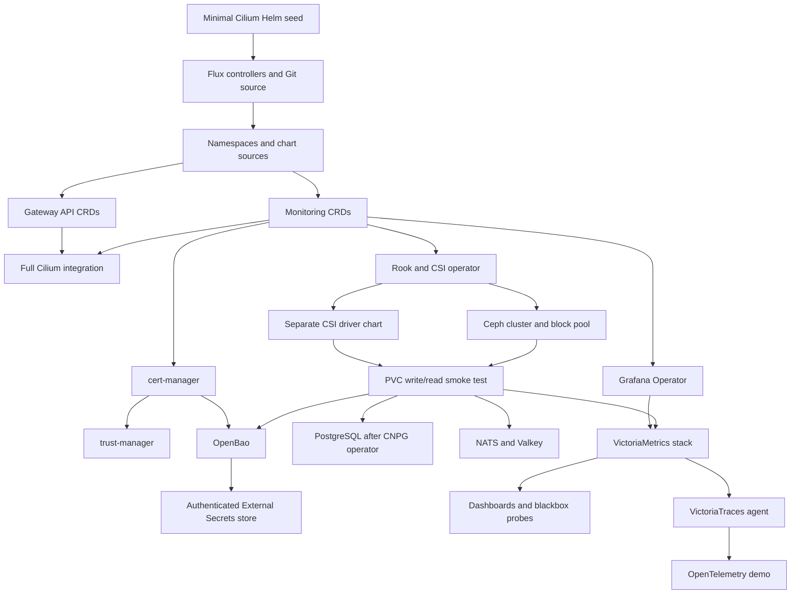

# Deployment order and ownership

The shared `infrastructure/` directories are reusable, suspended templates.
`clusters/iximiuz-platform/` enables them with cluster-specific values. The older
`clusters/iximiuz-labs/` overlay belongs to a separate, smaller play.

Flux reads `main` over public HTTPS. The root `flux-system` Kustomization applies
its own manifests and the child Kustomizations in `infrastructure.yaml`.
Kustomize file order does not establish controller readiness; `dependsOn` and
health checks do.

The initial Cilium seed disables Gateway API and ServiceMonitor resources because
their CRDs do not exist yet. Flux later takes over the same Helm release and
loads the full cluster settings. Foundation must not depend on that later Cilium
reconciliation: doing so would create a CRD/CNI dependency cycle.

The chart release name for Cilium remains `cilium` in `kube-system`. Flux upgraded
the original Helm release successfully; there is no second CNI installation.

## Readiness gates

- Rook's HelmRelease being Ready does not mean a Ceph cluster exists.
- The cluster chart being Ready does not mean its asynchronous storage is usable.
- CephCluster and CephBlockPool use explicit CEL expressions.
- `storage-ready` waits for a real mounted RBD PVC to pass a write/read Job.
- PostgreSQL waits for `status.readyInstances == spec.instances` (three in this
  overlay), not just acceptance of its CR.
- OpenBao additionally waits for its StatefulSet; an installed chart can still
  contain sealed, unready servers.
- SecretStore and ExternalSecret wait for their Ready conditions.

`HEALTH_WARN` is permitted by the lab Ceph gate because the observed Ceph/key
compatibility warnings do not prevent I/O. This is deliberately broader than
`HEALTH_OK`: it is not proof that every possible warning is harmless. Inspect
`ceph health detail` before treating storage as healthy for a different use case.

Ceph, PostgreSQL, OpenBao, CSI resources, the storage-check PVC, the secret store,
and Gateway API disable Flux pruning. This protects against accidental Git
removal; explicit Helm uninstalls, PVC deletion, or lost lab disks can still delete
data. Replication and `prune: false` are not backups.

The lab caps Kustomize controller reconciliation concurrency at four. This reduces
bootstrap API bursts; it is not a substitute for sufficient control-plane capacity.
