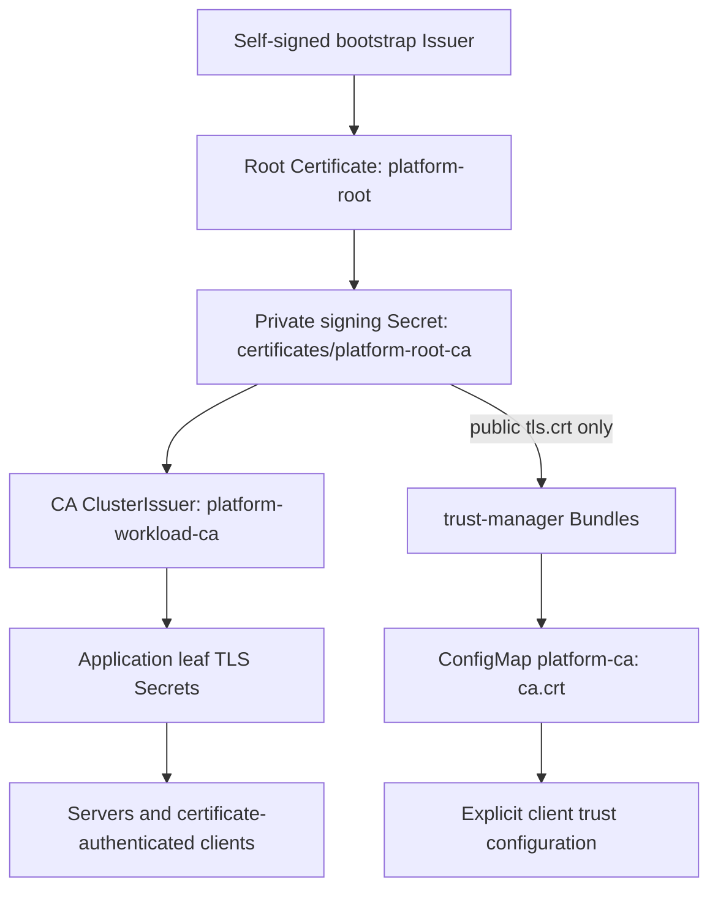

# Current application PKI architecture and coverage

Reviewed **2026-11-02, Europe/Istanbul**, against the templates and evidence
through `d5fa825`. This is a repository/evidence inventory, not a live production
cluster inventory. The referenced validation playgrounds were destroyed after
publishing their results. The [interrupted full-platform migration](../findings/pki-last-run.md)
is historical; later focused tests verify the specific connections listed below.

## Who issues certificates and who trusts them

**cert-manager is our certificate issuer. OpenBao is not the signing backend.**
The selected `ClusterIssuer/platform-workload-ca` is a cert-manager **CA issuer**
backed by `certificates/platform-root-ca`. It signs application leaves directly
with the online root key. There is no deployed intermediate CA or OpenBao PKI
secrets-engine/cert-manager Vault Issuer integration.

The bootstrap Issuer is namespaced `certificates/platform-root-bootstrap`.
Root settings are RSA 2048-bit, duration `87600h` (about ten years), renewBefore `8760h`,
and private-key rotationPolicy `Never`. Its historical common name remains
`openbao-injector-ca`; that name does not make OpenBao the authority. The root
certificate is the trust anchor and its private key signs leaves; the root is
not mounted as an application's serving certificate.

trust-manager distributes the **public root only** into `ConfigMap/platform-ca`,
key `ca.crt`, across namespaces selected by the Bundle (currently all). A separate
Bundle distributes a public CA Secret `kyverno/kyverno-platform-ca`, key `tls.crt`.
Applications must explicitly consume the appropriate trust material; distribution
does not enable TLS, inject mounts or change system trust automatically. Charts
may instead wire `ca.crt` from their issued leaf Secret or webhook CA bundles.

## Ownership boundaries

| Material | Current owner and responsibility |
| --- | --- |
| Root/signing key and centrally issued leaf keys | cert-manager; protect signing-key/issuer/CertificateRequest access through RBAC and independent key custody |
| Public CA distribution | trust-manager; no private keys in target Bundles |
| Loading/reloading serving certificates | Each application/operator; renewal is not proof of reload |
| Application passwords/API tokens | Optional OpenBao KV → External Secrets → Kubernetes Secrets, or agent-rendered files for Deployment primitives |
| CNPG-generated database passwords | CNPG; application ESO opt-ins do not take ownership of these Secrets |
| OpenBao initialization/unseal/recovery material | Independent secure custody, outside the OpenBao/ESO bootstrap dependency cycle |
| Kubernetes and controller bootstrap PKI | Their existing controllers/cluster lifecycle, as documented below |

[Application credential opt-ins](../operations/application-external-secrets.md)
manage passwords/tokens, not PKI. The live infrastructure tests cover all nine
opt-ins/ten Secret contracts, but do not establish new serving-TLS coverage for
those applications. ESO policies require self-token lookup/renew/revoke in addition
to exact-path KV reads; that runtime correction does not broaden certificate ownership.

## Configured connections and verification scope

“Configured” below means the template requests the integration. It does not mean
its complete TLS, admission, renewal and failure behavior has been tested live.

| Component / connection | Current configuration | Evidence and limits |
| --- | --- | --- |
| OpenBao server | Central `openbao-server-tls`, mounted into the HTTPS listener | Verified HTTPS used by real ESO stores and agent clients in fresh runs; renewed serving serial/reload and root rotation remain unverified |
| OpenBao injector webhook and injected agents | Centrally issued webhook certificate/CA injection; injector supplies public server CA bytes to agents | [Injector runtime](../findings/deployment-injector-runtime-2026-11-01.md): real admission, verified backend access, file refresh and reauthentication. This is not webhook certificate-renewal acceptance |
| External Secrets webhook | Chart-native cert-manager Certificate uses central issuer; old certificate controller disabled | Fresh deployments and real CR admission/secret delivery passed in the [infrastructure ESO runs](../operations/application-external-secrets.md#validation-scope); renewed webhook serial/reload not tested |
| Application and primitive SecretStores → OpenBao | Explicit HTTPS endpoint and public `platform-ca` ConfigMap | Live authenticated delivery and access denials passed. Original `secrets/openbao` verification store still reads only `ca.crt` from `openbao-server-tls`; it is a separate legacy trust reference |
| trust-manager serving endpoint | Chart Certificate patched to central ClusterIssuer | Repeated fresh installs and working Bundle distribution; no dedicated serving renewal/negative-handshake suite |
| Hubble node TLS and Relay client identity | Chart-native cert-manager method, explicit central ClusterIssuer | [Network PKI tests](../findings/central-pki-network-2026-11-01.md): verified node TLS/mTLS, 3/3 connected nodes, flow RPCs, wrong-CA/name rejection and hot renewal |
| Hubble Relay serving endpoint | Shared base does not explicitly enable Relay serving TLS/mTLS | The same focused run explicitly enabled and verified it as a **run override**; do not attribute that override to the shared default |
| ClickHouse operator webhook and secure metrics | Explicit central issuer replaces chart fallback self-signed Issuer | Network PKI tests verified handshakes, wrong CA/name rejection, admission CA bundles/dry runs and hot renewal |
| ClickHouse database listener | No database serving TLS configured by this base | [ESO SQL verification](../findings/infra-eso-data-2026-11-01.md) proves password use, not database TLS |
| LiteLLM/SonarQube dedicated CNPG PostgreSQL opt-ins | Separate central server/replication leaves; Cluster Secret refs; applications mount public Bundle only | [PostgreSQL PKI tests](../findings/central-pki-postgresql-2026-11-01.md): verified TLS/negative probes, SQL/app operations, hot renewal and primary failover |
| Generic CNPG `application-db` | Central server/replication leaf references | Older generic-cluster migration remains unverified; the dedicated application tests do not prove its in-place CA handover |
| CNPG operator webhook | Operator-managed PKI | Deliberate exception; replacing only a leaf would create competing lifecycle ownership |
| Metrics Server serving endpoint / APIService / scrape | Central cert-manager integration, CA injection and explicit scrape verification | Configured; earlier interrupted-run evidence is not a new complete handshake/renewal acceptance test |
| Metrics Server → kubelets | Kubernetes/node serving PKI | Shared values do not add `--kubelet-insecure-tls`. A removed historical lab overlay used that exception; consuming clusters must supply trusted node certificates/address SANs |
| Kyverno admission/cleanup webhooks | Direct central-root-signed leaves, public CA Secret, internal certificate writers disabled | Pinned readiness validator rejects delegated multi-certificate leaf chains; current direct-root integration still needs a fresh stable rollout/renewal test |
| VictoriaMetrics Operator webhook | Chart-native central cert-manager integration | Focused monitor runtime installed the operator and admitted scrape resources; no dedicated webhook chain/renewal acceptance suite |
| NATS client and cluster routes | Central server/client-capable leaf; route peer verification; no mandatory client certificate on client port | Issuance/configuration evidence only; full TLS rollout, quorum, plaintext rejection and hot renewal remain open. Latest NUI tests used an isolated fixture |
| Valkey client endpoint | Central server leaf, TLS-only listener, CA-verifying exporter; no required client certificate | Configured; end-to-end TLS/reload suite remains open. Latest RedisInsight tests used an isolated password-authenticated Redis fixture |
| Rook/Ceph dashboard | Central RSA leaf via `sslCertificateRef` | Configured; served chain, post-renewal serial/reload acceptance remains open |
| cert-manager bootstrap webhook | Independently managed bootstrap CA | Intentional dependency boundary; does not depend on the application issuer it must bootstrap |
| Kubernetes API, etcd, control plane and kubelets | Kubernetes distribution/cluster lifecycle PKI | Intentionally independent from application PKI |
| Grafana, Headlamp, Flux UI, LiteLLM/SonarQube serving interfaces, RedisInsight/NUI and most telemetry endpoints | Internal HTTP/plaintext unless consuming configuration adds TLS | Central trust does not convert these listeners to HTTPS |
| Tetragon / Trivy Operator | Tetragon local Unix control socket and HTTP metrics; Trivy HTTP metrics | External registry/database HTTPS uses configured trust, not automatically our Bundle |
| Velero object store | Provider HTTPS/default trust or explicitly configured BSL public CA | Latest real backup/restore used a local **HTTP** authenticated S3 fixture; external bucket TLS and central-CA integration remain unverified |

## Remaining acceptance work

- Existing-cluster CA migration, root replacement with trust overlap, and any
  intermediate/offline-root design remain separate work; fresh-leaf tests do not
  verify them.
- Complete focused TLS/renewal suites for NATS, Valkey, Kyverno, Rook dashboard and
  other configured-only endpoints. Keep serving TLS, client verification, mTLS,
  admission trust and process reload as separate acceptance checks.
- Verify OpenBao/injector and ESO webhook renewed serials and client continuity.
  Secret updates, successful credential refresh and changed OpenBao token lifetimes
  do not prove certificate reload.
- There is no installed certificate-policy template enforcing issuer choices.
  RBAC and explicit issuer/key access remain the control boundary.

Historical PKI run folders were removed as requested; their findings/evidence
remain. Reproduce the original configs from the revisions named in those reports,
or create a fresh isolated run. Never reuse a destroyed playground's CA, recovery
material or run identity as though it were still present.
